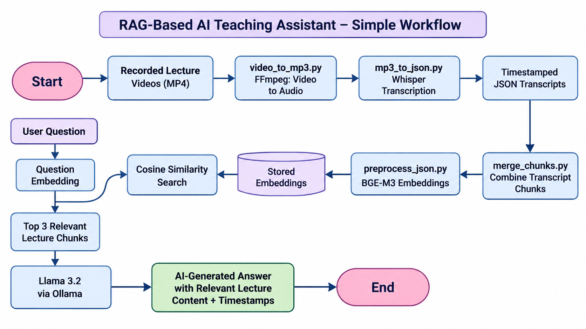
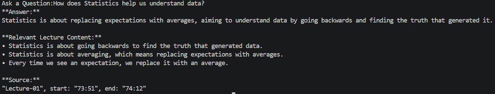
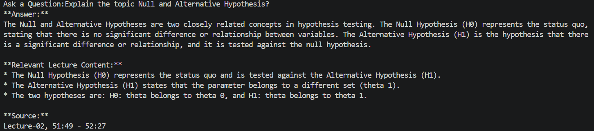

# RAG-Based AI Teaching Assistant for Statistics

An AI-powered lecture search assistant that helps users find relevant explanations in recorded lectures, understand the basic idea of a topic, and locate where it was discussed.

## Project Overview

Finding a particular concept in long recorded lectures can be time-consuming. This project uses Retrieval-Augmented Generation (RAG) to make that process easier.

Users can ask questions in natural language, and the system retrieves relevant lecture excerpts to generate an AI-based response along with the lecture title, number, and timestamps.

The goal is not to replace the original lecture, but to help users find the right information and revisit the relevant part of the video without searching through the entire recording.

## Key Features

- **Video-to-Audio Conversion:** Converts recorded MP4 lecture videos into audio using FFmpeg.
- **Automatic Transcription:** Uses Whisper (large-v2) to convert audio into text with timestamps.
- **Text Processing:** Combines transcript chunks to prepare lecture content for retrieval.
- **Semantic Search:** Uses BGE-M3 embeddings and cosine similarity to find relevant lecture content.
- **AI-Generated Responses:** Uses Llama 3.2 through Ollama to generate answers based on retrieved lecture context.
- **Timestamp-Based Retrieval:** Provides relevant lecture titles, numbers, and timestamps to help users locate the topic in the original video.

## Dataset

The project uses three recorded English-language Statistics lectures covering:

- Introduction to Statistics
- Parametric Hypothesis Testing
- Hypothesis Testing

## Project Workflow

The project follows two main stages: processing lecture videos and answering user questions.

### Workflow Explanation

1. Recorded lecture videos are converted into audio using FFmpeg.
2. Whisper transcribes the audio into timestamped JSON files.
3. Transcript chunks are combined using `merge_chunks.py`.
4. BGE-M3 generates embeddings from the processed lecture content.
5. When a user asks a question, its embedding is generated.
6. Cosine similarity retrieves the top 3 relevant lecture chunks.
7. Llama 3.2 generates an answer using the retrieved context and provides relevant lecture references.

## Sample Outputs

The following screenshots show examples of questions asked and responses generated by the system.

### 1. Understanding Statistics

### 2. Understanding Null and Alternative Hypothesis

*Note: The responses are AI-generated using the retrieved lecture content. The purpose is to provide a basic understanding of the topic and help users locate relevant explanations in the original videos, rather than replace the complete lecture or guarantee independently verified answers.*

## Tech Stack

- **Programming Language:** Python
- **Speech-to-Text:** Whisper (large-v2)
- **Embedding Model:** BGE-M3
- **Language Model:** Llama 3.2
- **Local Model Runtime:** Ollama
- **Video Processing:** FFmpeg
- **Libraries:** Pandas, NumPy, Scikit-learn, Joblib, Requests

## Practical Applications

The same approach can be adapted to different domains where information is stored in lengthy recorded content or documents.

- **Education:** Find explanations of specific topics in recorded classes and training sessions.
- **Corporate Training:** Help employees locate procedures and information from recorded training videos.
- **Healthcare Training:** Retrieve relevant information from recorded professional training and educational sessions.
- **Technical Documentation:** Build question-answering systems that retrieve relevant information from large collections of technical documents.
- **Research and Learning:** Locate relevant discussions and information in long recorded seminars, presentations, and lectures.

## Limitations and Future Improvements

- The current dataset contains three English-language Statistics lectures.
- Answer quality depends on the relevance and completeness of the retrieved content.
- The system may provide incomplete answers when the available lecture context does not contain enough information.
- Future improvements may include support for more videos, additional subjects, larger datasets, and a user-friendly interface.

## Key Learning

Through this project, I gained practical experience with Retrieval-Augmented Generation (RAG), speech-to-text processing, text embeddings, semantic search, vector similarity, prompt engineering, and integrating locally running language models.
